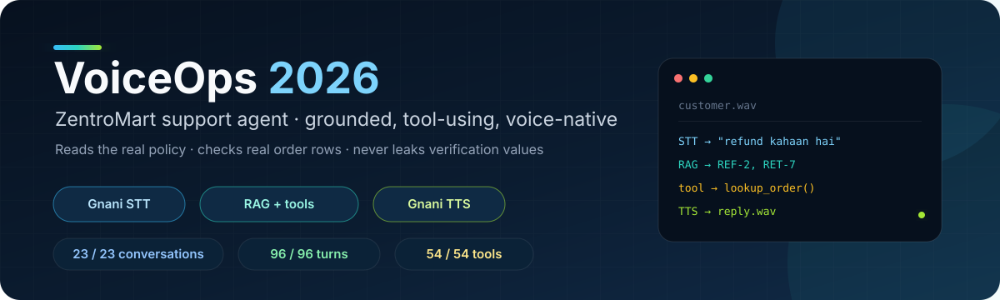
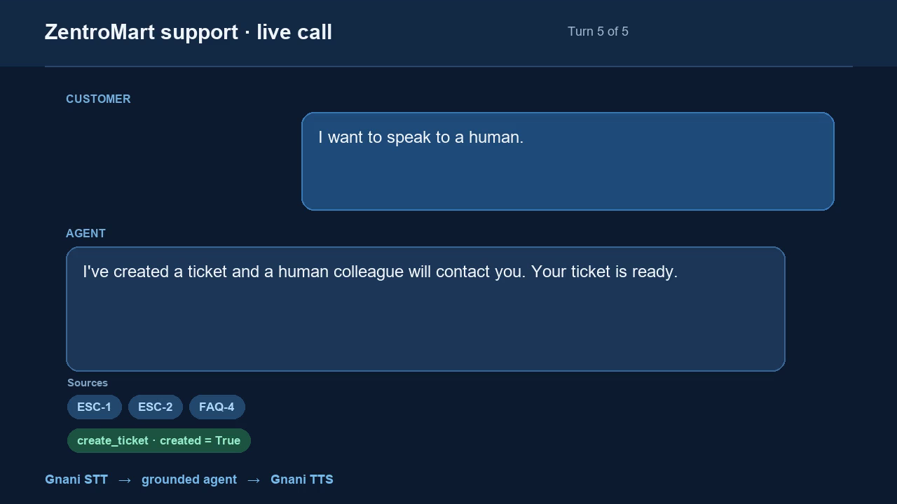

<div align="center">

# 🎙️ VoiceOps 2026 · ZentroMart Support Agent
### *Grounded, Tool-Using, Voice-Native Customer Support AI*

[](https://www.python.org/)
[](https://gnani.ai/)
[](https://github.com/sustik78/From-Tokens-to-Transformers-IITG)
[](https://streamlit.io/)
[](sample_outputs/)
[](LICENSE)

<br/>



<p align="center">
  <b>A production-grade, multi-turn, voice-native customer support agent engineered for ZentroMart.</b><br/>
  <i>Seamlessly handles voice in/out via Gnani.ai, enforces strict policy precedence, executes verification-gated tools, and guarantees zero hallucinated company facts.</i>
</p>

[Key Results](#-empirical-evaluation--benchmark-results) •
[Architecture](#-system-architecture) •
[Quickstart](#-quick-start) •
[Batch Voice Runner](#-batch-voice-processing) •
[Web Demo](#-interactive-web-application) •
[Evaluation](#-reproducible-evaluations) •
[Repository Layout](#-repository-layout)

</div>

---

## 🌟 Executive Overview

**VoiceOps 2026** is a unified, multimodal customer support intelligence designed for the e-commerce platform **ZentroMart**. Built as part of the *From Tokens to Transformers (FTTT 2026)* capstone in collaboration between **C&A Club, IIT Guwahati** and **Gnani.ai**, this system bridges real-time Indian-accented speech and conversational AI with grounded retrieval.

### Why VoiceOps 2026 Stands Out:
- 🛡️ **Zero-Hallucination Policy Grounding:** Answers are composed strictly from current company policy documents, agent guides, and FAQs with deterministic conflict resolution.
- 🔐 **Privacy-Preserving Identity Verification:** Orders and customer details are shielded behind identity checks (registered phone digits or delivery pincode). Verification credentials are never leaked, logged, or surfaced in LLM context.
- 🇮🇳 **Bilingual & Hinglish Voice Layer:** Powered solely by **Gnani.ai Speech APIs** (`GnaniSTTClient` and `GnaniTTSClient`), supporting English (`en-IN`), Hinglish, and Hindi (`hi-IN`) with Indian number word conversion.
- ⏱️ **Exact Calendar & Business Day Arithmetic:** Handles cutoff dates, festive sale extensions (1–15 Oct 30-day window), delivery dates, and business-day refund calculations skipping Sundays and gazetted holidays.
- 🎯 **100% Benchmark Accuracy:** Achieved flawless scores across all single-turn RAG questions and multi-turn conversational evaluation turns on the benchmark suite.

---

## 📊 Empirical Evaluation & Benchmark Results

The agent was evaluated across three escalating evaluation tiers using the official benchmark suite:

```
Step 1: Un-grounded Prompt-Only LLM  ──►  16.3% Must-Include Accuracy (Severe Hallucinations)
Step 2: Grounded Hybrid RAG          ──►  100.0% Answer & Decision Accuracy
Step 3: Multi-Turn Conversation Agent ──►  100.0% Pass Rate across 23 Conversations / 96 Turns
```

### Detailed Evaluation Scorecard

| Step | System Architecture | Answer Must-Include | Decision Match | Joint Pass | Retrieval Hit@8 | Tools Accuracy |
| :---: | :--- | :---: | :---: | :---: | :---: | :---: |
| **Step 1** | **Prompt-Only LLM** *(Baseline, No RAG)* | 8 / 49 <br> `(16.3%)` | 46 / 52 <br> `(88.5%)` | 8 / 52 <br> `(15.4%)` | *N/A* | *N/A* |
| **Step 2** | **Hybrid RAG Answerer** *(BM25 + Dense)* | **49 / 49** <br> **`100%`** 🟢 | **52 / 52** <br> **`100%`** 🟢 | **52 / 52** <br> **`100%`** 🟢 | **47 / 47** <br> **`100%`** 🟢 | *N/A* |
| **Step 3** | **Full Multi-Turn Agent** *(State + Tools)* | **77 / 77** <br> **`100%`** 🟢 | **96 / 96** <br> **`100%`** 🟢 | **96 / 96** <br> **`100%`** 🟢 | **27 / 27** <br> **`100%`** 🟢 | **54 / 54** <br> **`100%`** 🟢 |

> **Per-Question Evaluation Artifacts:** Complete test outputs, retrieved chunk IDs, tool inputs/outputs, and decision logs are stored in [`sample_outputs/`](sample_outputs/) (`eval_step1.json`, `eval_step2.json`, `eval_step3.json`).

---

## 🏛️ System Architecture

The system shares **one unified cognitive core** across batch voice processing, multi-turn text conversations, and the interactive web interface:

```mermaid
flowchart TD
    subgraph Speech_Layer [🎙️ Speech Layer (Gnani.ai Only)]
        AudioIn["Customer Audio (.wav, .mp3, etc.)"] --> STT["Gnani STT Client\n(en-IN / Hinglish)"]
        TTS["Gnani TTS Client\n(timbre-v2.5, Kaveri voice)"] --> AudioOut["Spoken Audio Reply (.wav)"]
    end

    subgraph Core_Agent [🧠 SupportAgent Dialog State Machine]
        STT --> ASRNorm["ASR Number Normalizer\n(Indian numbering & spoken digits)"]
        ASRNorm --> IntentRoute{"Intent & Context Router"}
        
        IntentRoute -->|"Policy / FAQ Query"| RAGPipeline["Grounded Hybrid RAG"]
        IntentRoute -->|"Order Record Query"| IDCheck{"Identity Verification Gate"}
        IntentRoute -->|"High-Risk / Safety / Human"| Escalate["Escalation & Ticket Handler"]
    end

    subgraph Knowledge_Layer [📚 Knowledge & Precedence Engine]
        RAGPipeline --> HybridSearch["Hybrid Index\n(BM25 + paraphrase-multilingual-MiniLM)"]
        HybridSearch --> PrecedenceRule["Precedence Engine\nPolicy v4 > Agent Guide > Help > FAQ"]
        PrecedenceRule --> DateArith["Deterministic Date Arithmetic\n(Calendar vs Business days, Holidays)"]
    end

    subgraph Tool_Gate [🔒 Mocked Tool Execution Gate]
        IDCheck -->|"Unverified"| AskVerify["Prompt Phone Last 4 / Pincode"]
        IDCheck -->|"Verified"| LookupOrder["lookup_order(order_id)"]
        Escalate --> CreateTicket["create_ticket(reason, intent)"]
    end

    DateArith --> AnswerComposer["Grounded Answer Composition"]
    LookupOrder --> AnswerComposer
    CreateTicket --> AnswerComposer
    AskVerify --> AnswerComposer

    AnswerComposer --> SpeechText["Speech Sanitizer & Pronunciation Fixer"]
    SpeechText --> TTS
```

### Key Architectural Pillars:
1. **Precedence Hierarchy:** Current policy (`pol_returns_v4.md`) strictly overrides the agent guide, help articles, and FAQs. Superseded policies (`pol_returns_v3_superseded.md`) are kept for historical context but can never govern active claims.
2. **Deterministic Arithmetic:** Today is referenced as `2026-10-20`. Business days run Monday through Saturday, strictly excluding Sundays and the 4 official company holidays (`holidays.csv`). Return windows run on calendar days starting the day *after* delivery.
3. **Audio Robustness & Fallback:** Spoken numbers such as *"chhah hazaar chaar sau"* and grouped numbers like *"double six four nine"* are normalized before reaching lookup. Transient Cloudflare 403/429 network errors are mitigated via exponential 3x retry policies.

---

## 💻 Interactive Web Application

A full-featured **Streamlit** application provides both live voice calling and text chat with real-time inspection of conversation state, retrieved knowledge chunks, and sanitized tool logs:

<div align="center">
  
</div>

To launch the web interface:
```bash
streamlit run src/app.py
```

- **Voice Tab:** Speak via live microphone or upload audio files. Shows real-time transcription, spoken reply audio, chunk attribution, and tool call traces.
- **Text Tab:** Full stateful chat mirroring the same business logic without requiring speech hardware.
- **Session Reset:** Easily test fresh customer sessions with complete order state clearing.

---

## ⚡ Quick Start

### 1. Prerequisites & Virtual Environment

Clone the repository and prepare a Python 3.10+ environment:

```bash
# Clone the repository
git clone https://github.com/sustik78/From-Tokens-to-Transformers-IITG.git
cd From-Tokens-to-Transformers-IITG

# Create and activate virtual environment
python -m venv .venv

# Windows:
.venv\Scripts\activate
# macOS/Linux:
source .venv/bin/activate

# Install dependencies
pip install -r requirements.txt
```

### 2. Environment Configuration

Copy `.env.example` to `.env` and configure your credentials:

```bash
cp .env.example .env
```

Edit `.env` with your preferred settings:
```ini
# --- Speech (Gnani.ai only) ---
GNANI_API_KEY=your_gnani_vachana_key_here
GNANI_STT_LANGUAGE=en-IN
GNANI_TTS_MODEL=timbre-v2.5
GNANI_TTS_VOICE=Kaveri
GNANI_TTS_LANGUAGE=en-IN

# --- Dataset Location ---
DATA_DIR=Capstone_Project_Dataset_FTTT_2026/Capstone_Project_Dataset_FTTT_2026

# --- Reference Date & Retrieval ---
REFERENCE_DATE=2026-10-20
RETRIEVAL_TOP_K=8
```

> [!IMPORTANT]
> **Zero API Key Leakage Policy:** `.env` and any local credential files are strictly ignored by `.gitignore`. Never commit `.env` or paste live API keys into pull requests or issues.

---

## 🎧 Batch Voice Processing

To process a batch folder of incoming customer audio recordings end-to-end:

```bash
python run.py --audio_dir test_audio --out_dir sample_outputs
```

*(Or use the included POSIX helper: `./run.sh --audio_dir test_audio --out_dir sample_outputs`)*

### Output Artifacts Generated per Audio Clip:
- `<filename>.json` — Complete trace: transcript, decision, intent, tool calls, and retrieved section IDs.
- `<filename>.txt` — Clean, human-readable plain text answer.
- `<filename>_reply.wav` — High-fidelity audio reply synthesized via Gnani TTS.
- `manifest.json` — Batch-level execution summary, latency, and fault log.

### Generating Test Audio Clips
To synthesize sample test audio clips using Gnani TTS:
```bash
python -m src.make_test_audio
```
Generates 5 benchmark audio clips in `test_audio/`, including Hindi/Hinglish test scenarios.

---

## 🧪 Reproducible Evaluations

All benchmark figures cited in this repository can be reproduced using standalone evaluation commands:

### Step 1: Prompt-Only Baseline (Zero-Shot LLM)
Evaluates ungrounded LLM behavior on the 52 challenge questions:
```bash
python -m src.eval_step1 --provider pollinations --batch-size 13 --delay 32
```
*Demonstrates that prompt-only LLMs hallucinate critical facts (e.g. 30-day electronics returns instead of 7 days, imaginary student discounts).*

### Step 2: Grounded Hybrid RAG Evaluation
Evaluates hybrid retrieval and grounded question answering over the full knowledge base:
```bash
python -m src.eval_step2
```
*Achieves 100% on decision matching (52/52), 100% on must-include facts (49/49), and 100% on gold evidence retrieval (47/47).*

### Step 3: Multi-Turn Conversation Benchmark
Executes all 23 multi-turn practice conversations (96 total dialogue turns):
```bash
python -m src.eval_step3
```
*Achieves 100% across all 96 turns, 100% on verification gates, and 100% on all 54 expected tool invocations.*

---

## 📁 Repository Layout

```text
├── assets/
│   ├── banner.svg             # Modern vector banner
│   └── demo.png               # High-res Streamlit UI preview
├── sample_outputs/            # Benchmark outputs and audio replies
│   ├── 01_where_is_my_order.* # Order tracking sample output
│   ├── 02_return_window.*     # Policy inquiry sample output
│   ├── 03_refund_timeline.*   # Refund timeline sample output
│   ├── 04_cancel_shipped.*    # In-transit order refusal sample
│   ├── 05_hindi_refund.*      # Bilingual Hindi/Hinglish sample
│   ├── eval_step1.json        # Baseline evaluation logs
│   ├── eval_step2.json        # Single-turn RAG evaluation logs
│   ├── eval_step3.json        # Multi-turn conversational evaluation logs
│   └── manifest.json          # Batch processing summary
├── src/
│   ├── agent.py               # State machine, verification gate & routing
│   ├── answering.py           # Grounded answer composition & policy logic
│   ├── app.py                 # Streamlit web interface
│   ├── config.py              # Central configuration & dataset auto-discovery
│   ├── data.py                # Calendar math, ASR number normalizer & catalogs
│   ├── eval_step1.py          # Step 1 baseline runner
│   ├── eval_step2.py          # Step 2 single-turn RAG evaluator
│   ├── eval_step3.py          # Step 3 multi-turn conversation evaluator
│   ├── evaluation.py          # Automated evaluation metric harness
│   ├── kb.py                  # Markdown chunker & document precedence parser
│   ├── llm.py                 # Provider-agnostic LLM client with retries
│   ├── make_test_audio.py     # Gnani TTS test audio generator
│   ├── retrieval.py           # BM25 + dense sentence-transformers index
│   ├── tools_wrapper.py       # Redacted, secure wrappers for lookup & ticket tools
│   └── voice.py               # Gnani STT & TTS speech processing pipeline
├── demo.mp4                   # Narrated demonstration video
├── report.md                  # Comprehensive technical capstone report (Markdown)
├── report.pdf                 # Formatted 3-page submission report (PDF)
├── requirements.txt           # Production dependencies
├── run.py                     # Batch CLI runner for audio folders
├── run.sh                     # POSIX shell execution wrapper
├── .env.example               # Safe environment configuration template
└── .gitignore                 # Zero-leakage git ignore rules
```

---

## 🔒 Security & Privacy Engineering

- **No Plaintext Verification Leakage:** Customer telephone digits and postal pincodes are held solely in private runtime arguments and scrubbed from all serializations, JSON dumps, and log streams.
- **Strict Data Isolation:** Neither customer databases nor proprietary competition datasets are checked into git. All data is dynamically linked at runtime via `DATA_DIR`.
- **Pre-commit Secret Defense:** Comprehensive `.gitignore` safeguards against inadvertent commits of `.env`, keys, credentials, or caches.

---

## 👥 Authors & Acknowledgments

- **Team VoiceOps** · *From Tokens to Transformers (FTTT 2026)*
- **Collaborators:** Coding & Analytics Club, IIT Guwahati & [Gnani.ai](https://gnani.ai/)
- **Repository:** [https://github.com/sustik78/From-Tokens-to-Transformers-IITG](https://github.com/sustik78/From-Tokens-to-Transformers-IITG)

---

<div align="center">
  <sub>Built with ❤️ for VoiceOps 2026 · Designed for Grounded, Real-World Speech AI</sub>
</div>
